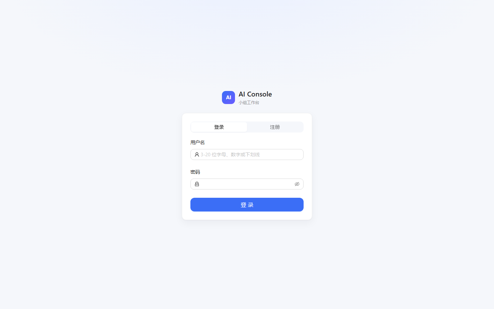
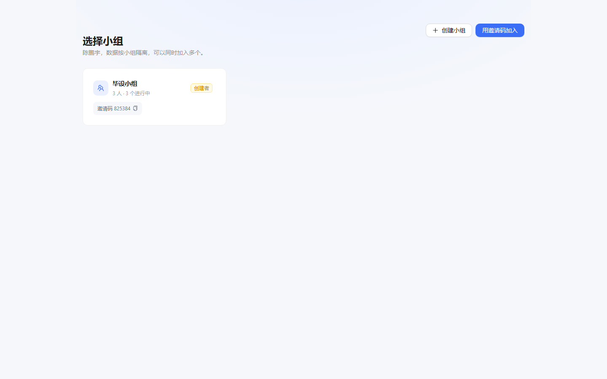
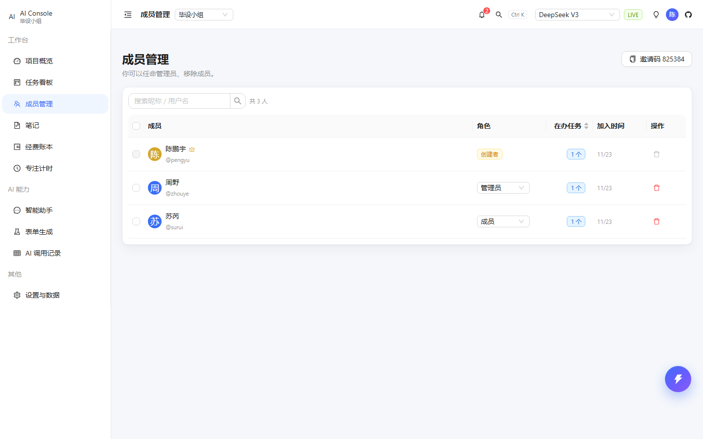

# AI Console · 团队工作台

一个给**小组 / 社团**用的工作台：项目概览、任务看板、成员、笔记（可分享）、经费账本（含 AA 结算）、专注计时，再加上三个 AI 能力模块（智能助手、表单生成、调用记录），最后一页放**数据备份**。

起因很具体：小组做项目时，任务在群里喊、会议记录在备忘录、班费在 Excel、专注靠自觉，四样东西四个地方。干脆合成一个。

现在是**带账号和多小组的服务端应用**：注册登录 → 创建或加入小组 → 数据存在 SQLite 里，换设备登进去还在。

前端 React 18 + TypeScript + Vite 5 + antd 5；服务端零依赖 Node，数据库用 Node 24 内置的 `node:sqlite`。

<p align="center">
  
</p>

<p align="center">
  
  
  
</p>

<p align="center">
  
  
</p>

---

## 为什么是「工作台」而不是「一个聊天页面」

只做一个 AI 对话页，能证明的东西很窄。做成工作台之后，同一个项目里覆盖了前端岗位真正会考的几类活：

| 模块 | 你在练什么 | 涉及技术 |
|---|---|---|
| **项目概览** | 数据可视化、信息层级、卡片布局 | 手写 SVG 环形图、CSS 柱状图、派生统计 |
| **任务看板** | 拖拽交互、乐观更新、抽屉表单 | HTML5 Drag & Drop、antd Form/Drawer |
| **成员管理** | 表格类后台：搜索/筛选/排序/多选/批量操作 | antd Table + rowSelection |
| **笔记** | 编辑器、自动保存、Markdown 渲染 | 受控 textarea + 防抖落盘 + 复用渲染器 |
| **经费账本** | 金额精度、统计、结算算法 | 以「分」存整数、贪心债务简化、分类占比 |
| **专注计时** | 计时器、后台节流、浏览器 API | 结束时间戳差值、Worker 计时、Web Audio、Notification |
| **登录 / 小组** | 认证、多租户、邀请机制 | scrypt 加盐密码、Bearer 会话、邀请码加入 |
| **权限模型** | 不同角色看到不同操作 | 创建者 / 管理员 / 成员三级，服务端二次校验 |
| **任务提醒** | 时间边界与通知 | 北京时间自然日切分、逾期标记、每分钟轮询 |
| **只读分享页** | 独立公开页面、数据最小暴露 | 独立路由（不带工作台外壳）+ 服务端内存存储 |
| **设置与数据** | 数据可迁移、危险操作防护 | 全量 JSON 导出/导入、存储占用统计、二次确认 |
| **智能助手** | 流式渲染、状态机、性能 | SSE、rAF 批处理、Markdown 增量渲染 |
| **表单生成** | 结构化输出 → 动态 UI | JSON Schema + zod 校验 |
| **调用记录** | 列表 + 详情 + 按访客隔离 | X-Visitor-Id、内存日志、限流 |

三个 AI 模块是**工作台里的功能**，不是整个产品。概览页的「让 AI 写周报」、看板卡片的「让 AI 拆解」都以 `?ask=` 参数跳到助手，跨模块联动。

---

## 快速开始

```bash
git clone <your-repo> && cd ai-console
npm install

cp .env.example .env      # Windows: copy .env.example .env
# 想用真实模型就填一个 Key（DeepSeek / 百炼 / 硅基流动 / 智谱 / 火山），不填走 mock

npm run dev
```

打开 <http://localhost:5173>：

1. 第一次来没有账号，点「注册」，用户名 3-20 位字母数字下划线，密码至少 6 位
2. 注册完会让你**创建小组**或**用邀请码加入**
3. 创建小组后你就是创建者，可以任命管理员

数据库文件在 `server/data/app.db`（已在 .gitignore 里）。删掉它等于清空所有数据。

| 命令 | 作用 |
|---|---|
| `npm run dev` | 同时启动 API 服务(8787) + 前端(5173) |
| `npm run api` | 只启动 API 服务 |
| `npm run build` | 类型检查 + 生产构建 |
| `npm run preview` | 预览构建产物（已配置 /api 代理） |
| `npm test` | 单元测试（Vitest） |
| `npm run lint` | ESLint |

**没有任何 Key 也能跑**：服务端会自动降级为 mock，仍然用真 SSE 推流，六个模块全部可用。

---

## 功能细节

### 项目概览
- 四张指标卡：任务总数 / 完成率 / 进行中 / 逾期（逾期按截止时间实时算）
- **近 7 天完成趋势**：CSS 柱状图，按完成时间聚合
- **状态分布**：SVG 环形图，用 `stroke-dasharray` 画弧，30 行代码，不引图表库
- 成员负载（在办任务数）、最近动态、即将到期
- 「让 AI 写周报」→ 把当前任务数据拼成 prompt，跳转到助手

> 为什么不用 ECharts：两个图不值得 300KB 依赖；而且手写之后**每个像素都能改**，面试时能讲清 `dasharray` / `dashoffset` 的原理。

### 任务看板
- 三列（待办 / 进行中 / 已完成），**跨列拖拽**，落点列高亮，拖动中卡片半透明
- 点卡片打开抽屉：改标题/描述/状态/优先级/负责人/截止日
- 卡片菜单：让 AI 拆解、删除
- 搜索 + 优先级筛选；移动端拖拽不可用时，改「状态」下拉即可
- 移到「已完成」自动写入完成时间，概览的趋势图立刻变化

### 成员管理
- 搜索（姓名/角色/邮箱）、状态筛选、按在办任务数排序
- 多选 + 批量移除；**移除成员时，TA 名下的任务自动变成「未指派」**（数据一致性）
- 新增/编辑走 Modal 表单，带邮箱格式校验

### 全局悬浮球
- 在任意页面都能用：语音提问 / 新建笔记 / 命令面板 / 切换主题
- 可拖动、松手吸附到最近边缘，位置记在本地；拖拽与点击用 4px 阈值区分
- 菜单项错峰入场（每项延迟 45ms），不是整块弹出

### 命令面板（Ctrl K）
- 全局快捷键唤起，模糊搜索页面与操作，方向键选择、Enter 执行、Esc 关闭
- 按平台显示 Ctrl K 或 ⌘K（
avigator.platform 判断），不会在 Windows 上显示 Mac 的符号
- 命令清单集中在一个数组里，新增页面加一条即可
- 入口有三个：Ctrl K、顶栏按钮、悬浮球菜单 —— 不知道快捷键的人也能找到

### 笔记
- 左侧列表（搜索标题/正文/标签）+ 右侧编辑器，支持 Markdown 预览
- **停止输入 600ms 才写 localStorage**，不是每个字符都打一次
- 置顶、删除、导出 `.md`、一键「让 AI 整理成会议纪要」
- 列表摘要会自动剥掉 `##` `**` 这些标记，不会把 Markdown 源码当正文显示

### 经费账本
- 记一笔：金额、分类、说明、谁垫付、谁分摊、日期
- **金额以「分」存整数**：`0.1 + 0.2 !== 0.3` 这种问题从数据层就消灭
- **AA 结算**：算每个人的净额，再用贪心配对生成「谁转给谁」的清单。
  4 个人最多 3 笔就能结清 —— 追求绝对最少笔数是 NP-hard，贪心足够且结果稳定
- 分类占比环形图、按月筛选、按金额/日期排序

### 专注计时
- 时长可自己调：预设 15 / 25 / 45 / 60，也能填任意分钟数（1–180），设置会记住
- 到点提醒有三层：页面内弹窗 + 声音 + **系统通知**。切到别的应用/最小化时也能看到，
  且**不会跳转页面**——弹窗关掉就还在原地
- **用「结束时间戳」算剩余，而不是每秒减一**：切到后台时 `setInterval` 会被浏览器节流，
  减法会让计时走慢，时间戳差值不会
- 可以绑定一个任务；标签页标题实时显示倒计时
- 今日 / 近 7 天柱状图，最近记录列表

### 智能助手
- SSE 逐字输出、Markdown 实时渲染、代码块复制、停止生成、重新生成
- **会话列表**：多会话、自动标题、本地持久化、重命名/删除
- 顶部**灵动岛**：生成中显示耗时，点开看指标并停止
- 右下**悬浮球**：可拖动、边缘吸附，快捷操作
- 支持 `?ask=` 从其他模块带入问题

### 表单生成
一句话描述 → 服务端让模型产出 **UI Schema** → 前端 zod 校验 → 渲染 antd 表单/表格。
模型只产 JSON，不产组件代码：最坏结果是渲染失败，而不是执行不可信代码。

### 调用记录
真实请求日志：模型、类型、Tokens、延迟、状态、问答摘要。
按 `X-Visitor-Id` 隔离 —— 内网穿透给别人用，他们只看到自己的记录。

---

## 技术亮点

### 1. 自研 SSE 解析器，而不是 EventSource
`EventSource` 只能 GET、不能带 header、不能带 body。用 `fetch` + `ReadableStream` 自己解协议（70 行）。
难点在**分包**：一个事件可能被拆到两次 `read()` 里，必须持有缓冲区，遇到空行才算一个事件。
`tests/sse.test.ts` 覆盖 8 种情况：拆包、粘包、多行 data、CRLF、心跳、流末尾无空行。
服务端 mock 还会**故意把一行 UTF-8 切在汉字中间**，验证 `TextDecoder({ stream: true })`。

### 2. 流式 Markdown 的「半成品补全」
模型刚吐到 ` ```ts ` 时围栏没闭合，`marked` 会把后文全吞进代码块。
解析前先补全结构（未闭合围栏、未闭合加粗），并避开代码块里的 `**` 运算符。所有输出过 DOMPurify。

### 3. rAF 批量渲染 + 后台兜底
每个 token 都 `setState` 会产生几百次提交。用 `requestAnimationFrame` 合并同帧增量。
**效果取决于到达速率**：token 密集时约减半，稀疏时接近 1:1（正常现象）。
后台标签页 rAF 会被暂停，所以加了 120ms `setTimeout` 兜底，否则切回来文字是冻住的。

### 4. 数据层：一个可替换的 store
任务/成员/活动全在 zustand 里，落 localStorage。将来接真接口，只要把这几个 action 换成 `fetch`，页面不用改。

### 5. 路由懒加载
六个页面按路由分包，首屏只加载 shell + 概览。改之前 436KB → 现在首屏约 **300KB gzip**（含 antd 基础组件）。

---

## 目录结构

```
src/
├─ main.tsx / App.tsx          入口、路由表、主题
├─ env.ts                      环境变量校验（zod）
├─ lib/
│  ├─ sse.ts                   SSE 协议解析（纯函数，可单测）
│  ├─ stream.ts                流式请求
│  ├─ markdown.ts              半成品补全 + 安全渲染
│  ├─ api.ts                   统一请求（自动带访客 id）
│  ├─ visitor.ts               访客标识
│  └─ models.ts                可用模型列表
├─ components/
│  ├─ AppShell.tsx             布局、分组导航、移动端抽屉
│  ├─ charts.tsx               SVG 环形图 + CSS 柱状图
│  ├─ DynamicIsland.tsx        灵动岛
│  ├─ FloatingBall.tsx         可拖拽悬浮球
│  └─ Markdown.tsx             渲染 + 代码块复制
├─ features/
│  ├─ workspace/               概览 / 看板 / 成员 + 数据 store
│  ├─ chat/                    会话列表、useChat 状态机、对话页
│  ├─ generator/               UI Schema 契约、动态渲染
│  └─ logs/                    调用记录
└─ styles/global.css           设计变量、深色主题、动效、断点
server/
├─ index.mjs                  HTTP 入口：模型路由 / 流式转发 / 日志 / 分享
├─ app-api.mjs                业务接口：认证 / 小组 / 成员权限 / 任务 / 账目 / 专注 / 提醒
└─ db.mjs                     SQLite 建表、查询、北京时间工具
tests/                         Vitest 用例
```

---

## 部署

```bash
docker build -t ai-console .
docker run -d -p 8787:8787 -e LLM_API_KEY=sk-xxx -v "$PWD/data:/app/data" ai-console
```

同一个 Node 进程既提供 `/api/*`，也在 `dist` 存在时把前端发出去（SPA 回退到 index.html）。
`-v` 挂 `data` 目录，容器重建不会丢库。

## 账号、权限与数据

| 角色 | 能做什么 |
|---|---|
| 创建者 owner | 任命/撤销管理员、移除任何成员、管理一切 |
| 管理员 admin | 移除普通成员、管理任务与账目 |
| 成员 member | 查看全部数据、增删改任务、记自己的账，不能动成员 |

这些约束都在服务端强制校验（前端只是隐藏按钮）：

- 创建者不能被移除，也不能改自己的角色
- 只有创建者能任命管理员；管理员不能移除另一个管理员
- 一个人可以同时在多个小组，任务、账目、成员按小组隔离
- 笔记属于**个人**，不进小组，换小组也看得到

数据存在 `server/data/app.db`（SQLite，WAL 模式）：

- 密码用 `scrypt` 加盐，库里只有 salt + hash，没有明文
- 登录态是 30 天的会话 token，存在 localStorage；XSS 能偷 token，所以 Markdown 渲染继续走 DOMPurify
- 任务提醒按**北京时间**的自然日算：今天到期的和已逾期的进铃铛
- 「今日专注」「本月支出」同样按北京时间切分 —— 把系统时区改成纽约，数字也不会错位

边界：会话记录和分享出去的笔记仍在内存里，服务重启清空（落库是下一步）。模型 Key 只活在 Node 进程，不下发到浏览器。

---

## Roadmap

- [ ] 找回密码 / 邮箱验证（现在忘了密码只能找管理员建新号）
- [ ] 会话与分享落库（现在是内存，重启即失）
- [ ] 任务详情评论与 @成员
- [ ] WebSocket 替代轮询做实时提醒
- [ ] Playwright E2E（登录 → 建组 → 拖任务 → 结算）

## 测试

`ash
npm test
`

40 个用例，重点覆盖容易出错、又不好手测的地方：

| 文件 | 覆盖什么 |
|---|---|
| 	ests/sse.test.ts | 分包、粘包、多行 data、CRLF、心跳、流末尾无空行 |
| 	ests/markdown.test.ts | 未闭合围栏/加粗、代码块里的 **、XSS 过滤 |
| 	ests/schema.test.ts | UI Schema 校验、非法字段类型、mock 匹配 |
| 	ests/settle.test.ts | AA 结算：平账、四人多笔、金额守恒、奇数分 |
| 	ests/notes.test.ts | 关键词/标签过滤、置顶排序、标签抽取 |

## License

MIT
