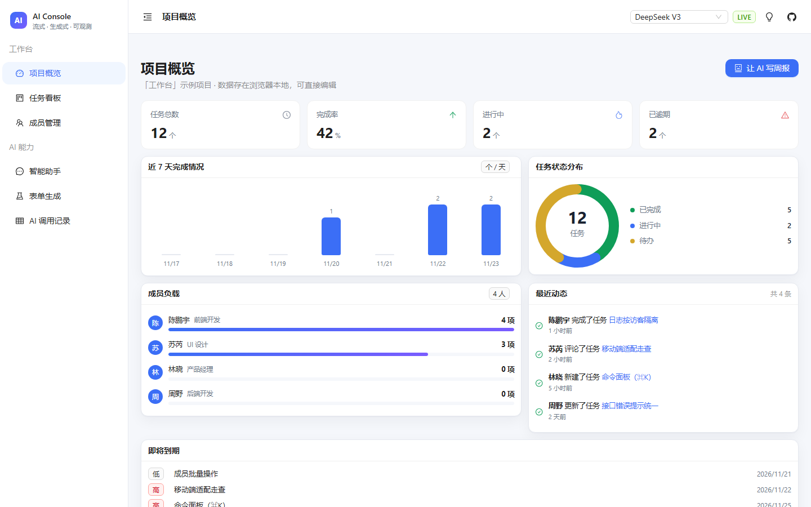
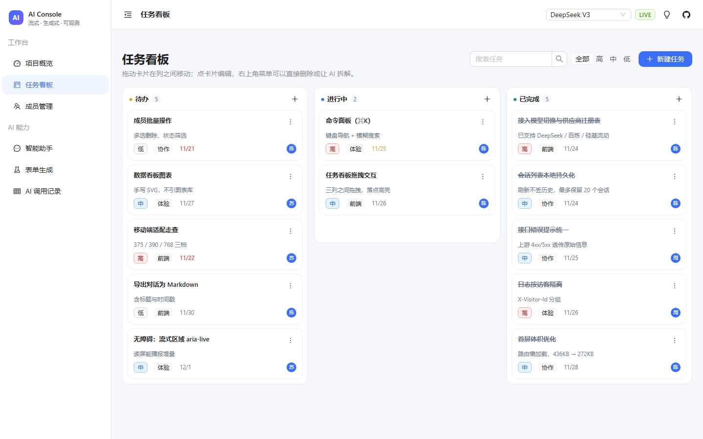

# AI Console · 团队工作台

一个**多模块的前端项目**：项目概览、任务看板、成员管理 + 三个 AI 能力模块（智能助手、表单生成、调用记录）。

React 18 + TypeScript + Vite 5 + antd 5，配一个零依赖的 Node 服务（可接真实模型，也可无 Key 跑 mock）。

<p align="center">
  
</p>

<p align="center">
  
  
</p>

---

## 为什么是「工作台」而不是「一个聊天页面」

只做一个 AI 对话页，能证明的东西很窄。做成工作台之后，同一个项目里覆盖了前端岗位真正会考的几类活：

| 模块 | 你在练什么 | 涉及技术 |
|---|---|---|
| **项目概览** | 数据可视化、信息层级、卡片布局 | 手写 SVG 环形图、CSS 柱状图、派生统计 |
| **任务看板** | 拖拽交互、乐观更新、抽屉表单 | HTML5 Drag & Drop、antd Form/Drawer |
| **成员管理** | 表格类后台：搜索/筛选/排序/多选/批量操作 | antd Table + rowSelection |
| **智能助手** | 流式渲染、状态机、性能 | SSE、rAF 批处理、Markdown 增量渲染 |
| **表单生成** | 结构化输出 → 动态 UI | JSON Schema + zod 校验 |
| **调用记录** | 列表 + 详情 + 按访客隔离 | X-Visitor-Id、内存日志、限流 |

三个 AI 模块是**工作台里的功能**，不是整个产品。概览页的「让 AI 写周报」、看板卡片的「让 AI 拆解」都以 `?ask=` 参数跳到助手，跨模块联动。

---

## 快速开始

```bash
git clone <your-repo> && cd ai-console
npm install

cp .env.example .env      # Windows: copy .env.example .env
# 填一个模型 Key（DeepSeek / 百炼 / 硅基流动 / 智谱 / 火山，任意一个即可）

npm run dev
```

打开 <http://localhost:5173>，默认进「项目概览」。

| 命令 | 作用 |
|---|---|
| `npm run dev` | 同时启动 API 服务(8787) + 前端(5173) |
| `npm run api` | 只启动 API 服务 |
| `npm run build` | 类型检查 + 生产构建 |
| `npm run preview` | 预览构建产物（已配置 /api 代理） |
| `npm test` | 单元测试（Vitest） |
| `npm run lint` | ESLint |

**没有任何 Key 也能跑**：服务端会自动降级为 mock，仍然用真 SSE 推流，六个模块全部可用。

---

## 功能细节

### 项目概览
- 四张指标卡：任务总数 / 完成率 / 进行中 / 逾期（逾期按截止时间实时算）
- **近 7 天完成趋势**：CSS 柱状图，按完成时间聚合
- **状态分布**：SVG 环形图，用 `stroke-dasharray` 画弧，30 行代码，不引图表库
- 成员负载（在办任务数）、最近动态、即将到期
- 「让 AI 写周报」→ 把当前任务数据拼成 prompt，跳转到助手

> 为什么不用 ECharts：两个图不值得 300KB 依赖；而且手写之后**每个像素都能改**，面试时能讲清 `dasharray` / `dashoffset` 的原理。

### 任务看板
- 三列（待办 / 进行中 / 已完成），**跨列拖拽**，落点列高亮，拖动中卡片半透明
- 点卡片打开抽屉：改标题/描述/状态/优先级/负责人/截止日
- 卡片菜单：让 AI 拆解、删除
- 搜索 + 优先级筛选；移动端拖拽不可用时，改「状态」下拉即可
- 移到「已完成」自动写入完成时间，概览的趋势图立刻变化

### 成员管理
- 搜索（姓名/角色/邮箱）、状态筛选、按在办任务数排序
- 多选 + 批量移除；**移除成员时，TA 名下的任务自动变成「未指派」**（数据一致性）
- 新增/编辑走 Modal 表单，带邮箱格式校验

### 智能助手
- SSE 逐字输出、Markdown 实时渲染、代码块复制、停止生成、重新生成
- **会话列表**：多会话、自动标题、本地持久化、重命名/删除
- 顶部**灵动岛**：生成中显示耗时，点开看指标并停止
- 右下**悬浮球**：可拖动、边缘吸附，快捷操作
- 支持 `?ask=` 从其他模块带入问题

### 表单生成
一句话描述 → 服务端让模型产出 **UI Schema** → 前端 zod 校验 → 渲染 antd 表单/表格。
模型只产 JSON，不产组件代码：最坏结果是渲染失败，而不是执行不可信代码。

### 调用记录
真实请求日志：模型、类型、Tokens、延迟、状态、问答摘要。
按 `X-Visitor-Id` 隔离 —— 内网穿透给别人用，他们只看到自己的记录。

---

## 技术亮点

### 1. 自研 SSE 解析器，而不是 EventSource
`EventSource` 只能 GET、不能带 header、不能带 body。用 `fetch` + `ReadableStream` 自己解协议（70 行）。
难点在**分包**：一个事件可能被拆到两次 `read()` 里，必须持有缓冲区，遇到空行才算一个事件。
`tests/sse.test.ts` 覆盖 8 种情况：拆包、粘包、多行 data、CRLF、心跳、流末尾无空行。
服务端 mock 还会**故意把一行 UTF-8 切在汉字中间**，验证 `TextDecoder({ stream: true })`。

### 2. 流式 Markdown 的「半成品补全」
模型刚吐到 ` ```ts ` 时围栏没闭合，`marked` 会把后文全吞进代码块。
解析前先补全结构（未闭合围栏、未闭合加粗），并避开代码块里的 `**` 运算符。所有输出过 DOMPurify。

### 3. rAF 批量渲染 + 后台兜底
每个 token 都 `setState` 会产生几百次提交。用 `requestAnimationFrame` 合并同帧增量。
**效果取决于到达速率**：token 密集时约减半，稀疏时接近 1:1（正常现象）。
后台标签页 rAF 会被暂停，所以加了 120ms `setTimeout` 兜底，否则切回来文字是冻住的。

### 4. 数据层：一个可替换的 store
任务/成员/活动全在 zustand 里，落 localStorage。将来接真接口，只要把这几个 action 换成 `fetch`，页面不用改。

### 5. 路由懒加载
六个页面按路由分包，首屏只加载 shell + 概览。改之前 436KB → 现在首屏约 **300KB gzip**（含 antd 基础组件）。

---

## 目录结构

```
src/
├─ main.tsx / App.tsx          入口、路由表、主题
├─ env.ts                      环境变量校验（zod）
├─ lib/
│  ├─ sse.ts                   SSE 协议解析（纯函数，可单测）
│  ├─ stream.ts                流式请求
│  ├─ markdown.ts              半成品补全 + 安全渲染
│  ├─ api.ts                   统一请求（自动带访客 id）
│  ├─ visitor.ts               访客标识
│  └─ models.ts                可用模型列表
├─ components/
│  ├─ AppShell.tsx             布局、分组导航、移动端抽屉
│  ├─ charts.tsx               SVG 环形图 + CSS 柱状图
│  ├─ DynamicIsland.tsx        灵动岛
│  ├─ FloatingBall.tsx         可拖拽悬浮球
│  └─ Markdown.tsx             渲染 + 代码块复制
├─ features/
│  ├─ workspace/               概览 / 看板 / 成员 + 数据 store
│  ├─ chat/                    会话列表、useChat 状态机、对话页
│  ├─ generator/               UI Schema 契约、动态渲染
│  └─ logs/                    调用记录
└─ styles/global.css           设计变量、深色主题、动效、断点
server/index.mjs               零依赖 API：模型路由 / 流式转发 / 日志 / 限流
tests/                         Vitest 用例
```

---

## 数据与边界

- 工作台数据（任务/成员）在 **localStorage**，换浏览器看不到；「重置」在概览页没有做，清空 `ai-console:workspace` 即可。
- 会话记录同样在 localStorage，最多 20 个会话、每个 200 条消息。
- 调用日志在**服务端内存**，重启清空；`visitorId` 不是鉴权，只用于隔离普通用户。
- 服务端限流：每访客每分钟 30 次，避免内网穿透后有人刷你的 Key。

---

## Roadmap

- [ ] 接真实后端（把 workspace store 的 action 换成 REST）
- [ ] 任务详情支持评论与附件
- [ ] 看板支持泳道（按成员分组）
- [ ] 虚拟列表（上千条消息时只渲染可视区）
- [ ] Playwright E2E

## License

MIT
