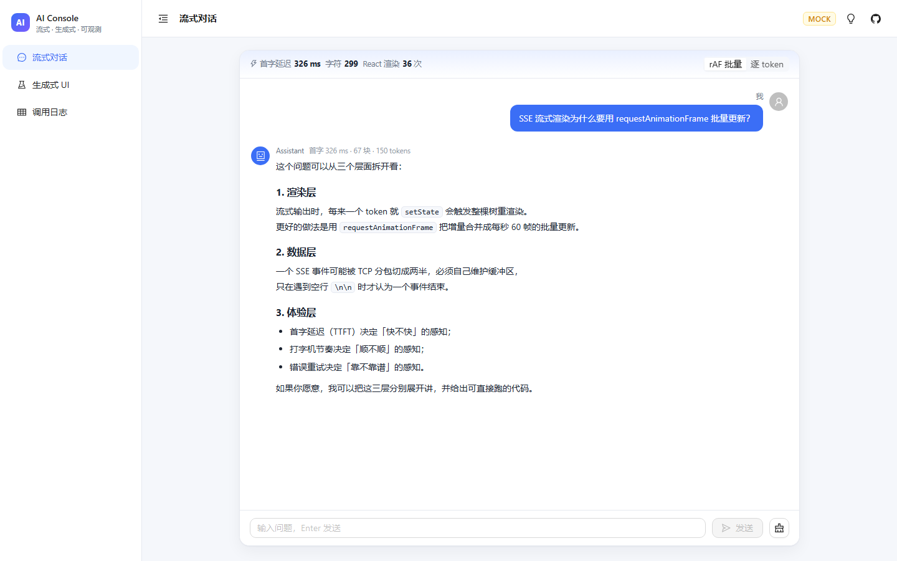
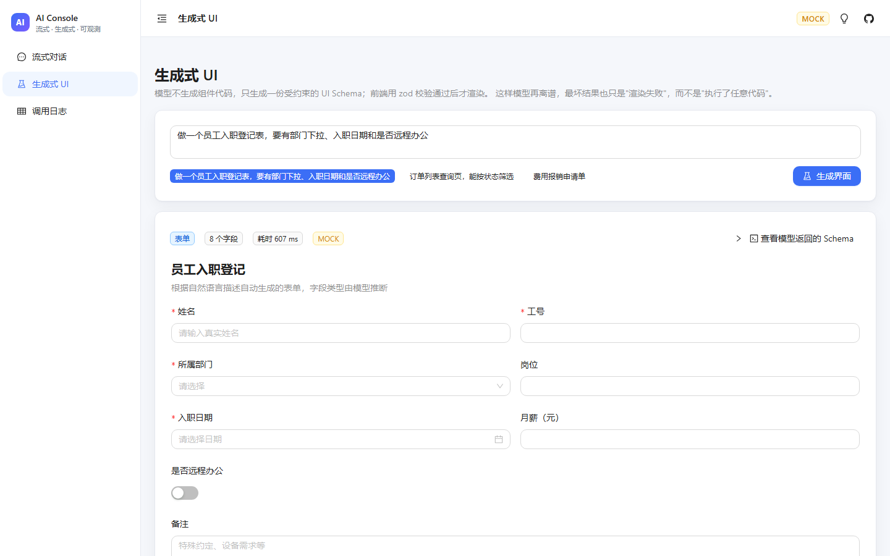
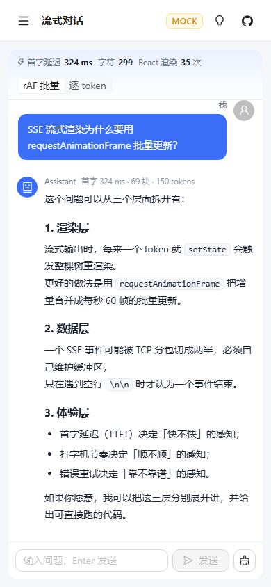

# AI Console

**一个可直接演示的 AI 前端工作台**：流式对话、生成式 UI、调用日志。
React 18 + TypeScript + Vite 5 + antd 5，零后端依赖即可跑通（内置 mock SSE 服务）。

<p align="center">
  
</p>

<p align="center">
  
  
</p>

---

## 快速开始

```bash
git clone <your-repo> && cd ai-console
npm install
npm run dev          # 同时起 mock 服务(8787) 和 vite(5173)
```

打开 <http://localhost:5173>。**不需要任何 API Key** —— mock 服务会真的用 SSE 推流。

想直接看效果：`/chat?demo=1`、`/generator?demo=1` 会自动跑一次演示。

| 命令 | 作用 |
|---|---|
| `npm run dev` | mock 服务 + 开发服务器 |
| `npm run build` | 类型检查 + 生产构建 |
| `npm run preview` | 预览构建产物 |
| `npm test` | 单元测试（Vitest） |
| `npm run lint` | ESLint |
| `npm run typecheck` | 仅类型检查 |

---

## 三个页面

### 1. 流式对话 `/chat`
SSE 逐字输出、Markdown 实时渲染、代码块复制、停止生成、错误提示。
顶部实时显示 **首字延迟 / 字符数 / React 渲染次数**，右上角可以切换「rAF 批量」与「逐 token」两种更新策略对比。

### 2. 生成式 UI `/generator`
输入一句自然语言 → 模型返回一份 **UI Schema** → zod 校验 → 渲染成 antd 表单或表格。
可以直接提交、查看模型原始 JSON。

### 3. 调用日志 `/logs`
一个后台列表页该有的都在这：筛选、排序、分页、状态标签、统计卡片、详情抽屉、成本估算。

---

## 技术亮点（以及取舍）

### 1. 自研 SSE 解析器，而不是 EventSource

`EventSource` 只能发 GET、不能带 header、不能带 request body —— 多轮对话把历史塞进 URL 很快就超长。
所以用 `fetch` + `ReadableStream` 自己解协议（`src/lib/sse.ts`，70 行）。

真正的坑在**分包**：一个事件可能被拆到两次 `read()` 里：

```
chunk1: 'event: delta\ndata: {"te'      chunk2: 'xt":"你好"}\n\n'
```

解析器必须持有缓冲区，只在遇到空行时才落地事件。`tests/sse.test.ts` 覆盖了 8 种情况：
拆包、粘包、多行 data、CRLF、心跳注释、流末尾无空行……

> mock 服务还会**故意把一行 UTF-8 切在汉字中间**再写出去，用来验证 `TextDecoder({ stream: true })` 用得对。

### 2. 流式 Markdown 的「半成品补全」

模型刚吐到 ```` ```ts ```` 的时候围栏还没闭合，`marked` 会把后面所有内容当成代码块，
页面就在「代码块」和「正文」之间反复横跳。

做法是解析前先补全结构（`repairStreamingMarkdown`）：未闭合围栏补围栏、未闭合加粗补加粗。
还要注意**代码块里的 `**` 是运算符**，不能当成加粗去补 —— 这条是单测逼出来的。

所有模型输出都过 DOMPurify，`dangerouslySetInnerHTML` 只吃消毒后的 HTML。

### 3. rAF 批量渲染 + 可量化的体感指标

每个 token 都 `setState`，一次回答就是几百次 React 提交。改成 `requestAnimationFrame` 合并同帧增量。

实测（mock 服务，68 个 chunk）：

| 策略 | React 渲染次数 | 说明 |
|---|---|---|
| 逐 token | 68 | 每个 chunk 提交一次 |
| rAF 批量 | **32** | 合并到帧，约为一半 |

页面上的数字是**跑出来的**，不是写死的文案，可以自己切换对比。

> 后台标签页里 rAF 会被浏览器暂停，所以加了 120ms 的 `setTimeout` 兜底，避免文字"冻住"。

### 4. 生成式 UI 走 Schema，不让模型写组件

模型直接产出 React 代码 = 执行不可信代码。所以定义一份受约束的契约：

```ts
uiSpecSchema = { title, layout: 'form' | 'table', fields: [{ name, label, type, required, options }] }
```

模型只产 JSON，前端用 zod 校验，通过才渲染。模型再离谱，最坏结果是「渲染失败」而不是「XSS / 任意代码执行」。

### 5. 路由懒加载与产物体积

| 产物 | 原始 | gzip |
|---|---|---|
| index（shell + antd 基础） | 548.9 KB | 173.9 KB |
| react 运行时 | 160.0 KB | 52.2 KB |
| ChatPage | 91.9 KB | 33.7 KB |
| GeneratorPage（按需） | 78.9 KB | 27.2 KB |
| Table + DatePicker（按需） | 439.9 KB | 137.7 KB |
| LogsPage（按需） | 31.6 KB | 10.9 KB |
| CSS | 7.1 KB | 2.3 KB |

首屏（`/chat`）gzip ≈ **272 KB**，改懒加载前是 **≈436 KB**，降了约 38%。
重组件（Table / DatePicker）只在进入表格页时才拉取。

---

## 脚手架能力

这不是"能跑就行"的玩具配置，而是一套可以复制到下一个项目的默认值：

- **路径别名** `@/` → `src/`（vite + tsconfig 双处配置）
- **环境变量类型安全**：`src/env.ts` 用 zod 校验，缺配置在第一屏就报错，而不是运行时 undefined
- **多环境**：`.env.development`（走本地 mock）/ `.env.production`（可指向真实后端）
- **开发代理**：`/api` → `127.0.0.1:8787`，前端不用处理 CORS
- **分包**：react 单独成 chunk，其余交给路由懒加载自然拆分
- **质量**：ESLint 9 flat config + Prettier + `tsc --noEmit`（strict，含 `noUncheckedIndexedAccess`）
- **测试**：Vitest + jsdom，25 个用例覆盖协议解析 / Markdown 补全 / Schema 校验
- **CI**：GitHub Actions（lint → typecheck → test → build）双 Node 版本矩阵
- **部署**：多阶段 Dockerfile + nginx（SPA fallback、gzip、静态资源长缓存）

---

## 目录结构

```
src/
├─ main.tsx / App.tsx        入口、路由、主题
├─ env.ts                    环境变量校验（zod）
├─ lib/
│  ├─ sse.ts                 SSE 协议解析（纯函数，可单测）
│  ├─ stream.ts              流式请求 + mock 生成器
│  ├─ markdown.ts            半成品补全 + 安全渲染
│  └─ utils.ts
├─ components/
│  ├─ AppShell.tsx           布局、导航、移动端抽屉、主题切换
│  └─ Markdown.tsx           渲染 + 代码块复制
├─ features/
│  ├─ chat/                  useChat 状态机、对话页
│  ├─ generator/             UI Schema 契约、动态渲染
│  └─ logs/                  后台列表页
└─ styles/global.css         设计变量、深色主题、移动端断点
server/mock.mjs              零依赖 mock 服务（SSE / 生成接口）
tests/                       Vitest 用例
```

---

## 移动端适配

- antd `Grid.useBreakpoint()` 切换侧边栏 ↔ 抽屉，不做两套代码；
- 聊天容器用 `100dvh`（而不是 `100vh`），避免移动端浏览器地址栏导致的高度抖动；
- 输入区 `padding-bottom: calc(12px + env(safe-area-inset-bottom))`，避开 iPhone 底部横条；
- 气泡 `max-width: calc(100% - 44px)`，长英文单词 `overflow-wrap: anywhere` 强制断行。

<p align="center"></p>

---

## Roadmap

- [ ] 接入真实后端（`VITE_USE_MOCK=false` 后走 `/chat/stream`，协议已对齐）
- [ ] 多轮上下文裁剪（按 token 预算滑窗 + 摘要）
- [ ] 对话持久化（IndexedDB）与历史会话列表
- [ ] 虚拟列表（上千条消息时只渲染可视区）
- [ ] Playwright E2E（首字延迟、流式渲染、移动端断点）

## License

MIT
