# 小组工作台 使用说明

一个给小组用的工作台：任务、成员、笔记、经费、专注时间都在一处，AI 只负责帮忙整理和生成，不替代你自己做决定。

适合这些人用：课程小组、社团、毕设团队、几个人的小工作室。

打开地址后，用管理员给你的链接访问即可，不需要安装任何东西。

---

> **关于 AI 功能**：项目默认不带 Key。没有 Key 时处于模拟模式，点击有反应但回复是预设内容；填上自己的 Key 才是真实模型。具体操作见最后一节「配置自己的 Key」。

## 目录

1. [注册与登录](#1-注册与登录)
2. [选择小组](#2-选择小组)
3. [项目概览](#3-项目概览)
4. [任务看板](#4-任务看板)
5. [成员管理](#5-成员管理)
6. [笔记](#6-笔记)
7. [经费账本](#7-经费账本)
8. [专注计时](#8-专注计时)
9. [智能助手](#9-智能助手)
10. [表单生成](#10-表单生成)
11. [AI 调用记录](#11-ai-调用记录)
12. [小组切换与提醒](#12-小组切换与提醒)
13. [设置与数据](#13-设置与数据)
14. [手机上使用](#14-手机上使用)
15. [数据说明](#15-数据说明)
16. [常见问题](#16-常见问题)
17. [配置自己的 Key](#17-配置自己的-key让-ai-真正可用)

---

## 1. 注册与登录

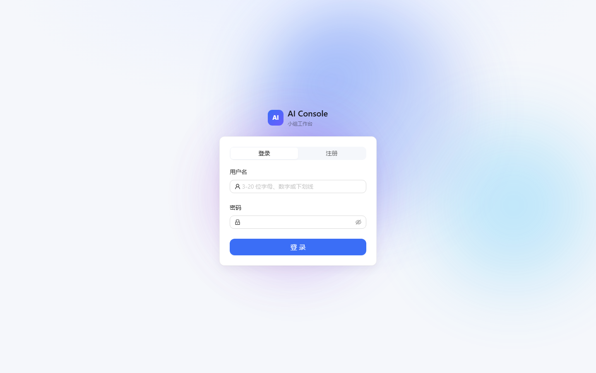

输入用户名和密码就能进。用户名规则：3–20 位字母、数字或下划线。

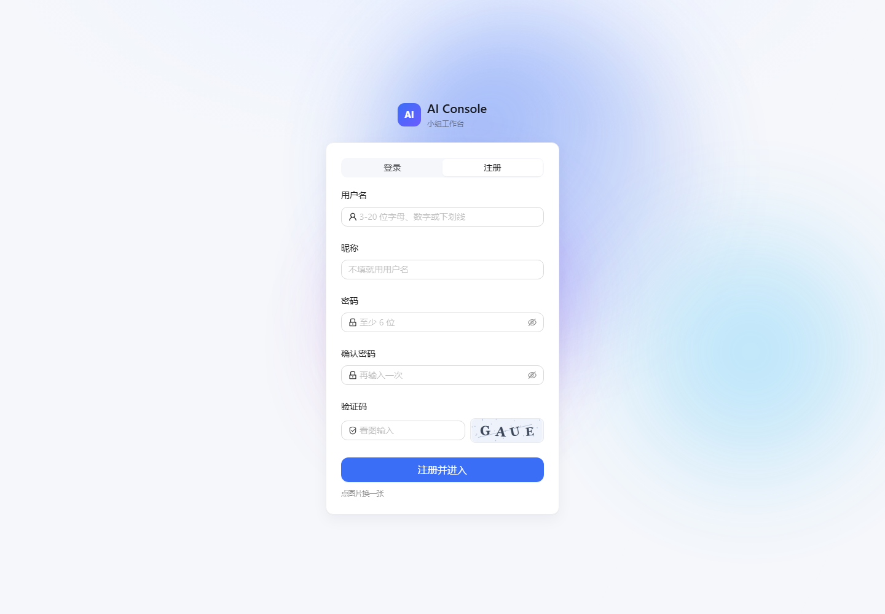

第一次使用点「注册」，需要填四样：

| 项目 | 说明 |
|---|---|
| 用户名 | 别人能看到，用来邀请你进小组 |
| 昵称 | 显示在任务和成员里，可以不填 |
| 密码 | 至少 6 位，下面有强度提示 |
| 确认密码 | 再输一次，防止打错 |
| 验证码 | 看图输入 4 位字符，看不清点图片换一张 |

密码强度会实时给建议（比如「还可以：至少 8 位更稳妥、加个符号」）。常见弱密码（如 `123456`、`password`）会直接被判为「弱」。

登录成功后会有一次过场动画，然后进入工作台。

---

## 2. 选择小组

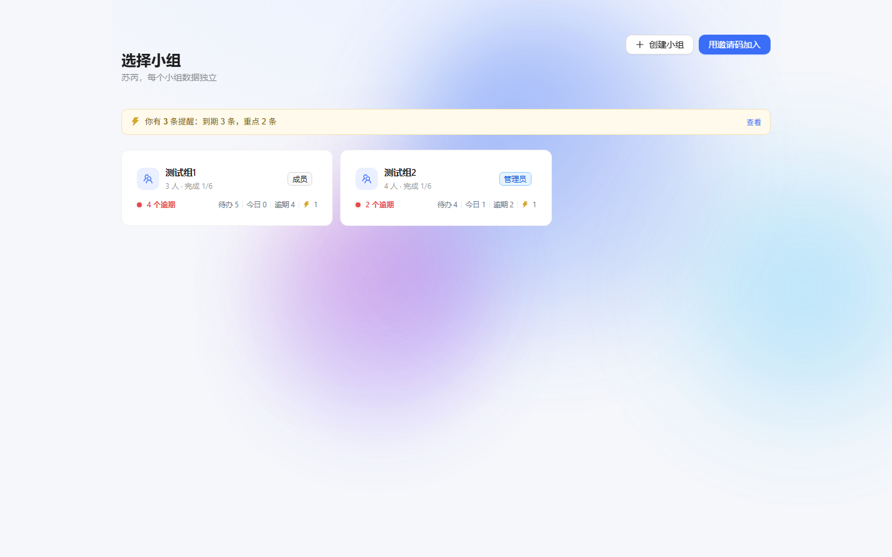

登录后如果是第一次，会让你**创建一个小组**或**用邀请码加入**。

每个人的数据按小组分开：换一个小组，看到的是另一套任务和账本。

每张小组卡片上有几个信息：

| 元素 | 含义 |
|---|---|
| 人数 · 完成 | 组里有几个人，已完成多少个任务 |
| 红/黄/绿/灰灯 | 红=有逾期，黄=今天到期，绿=正常，灰=还没有任务 |
| 待办 / 今日 / 逾期 / ⚡ | 分项计数，⚡ 是标记为重点的任务数 |
| 邀请码 | 创建者和管理员能看到，发给别人用来加入 |

如果今天有到期任务或你标记了重点，进来会先弹一个提醒窗（下面第 12 节有详细解释）。

点卡片进入这个小组。

---

## 3. 项目概览

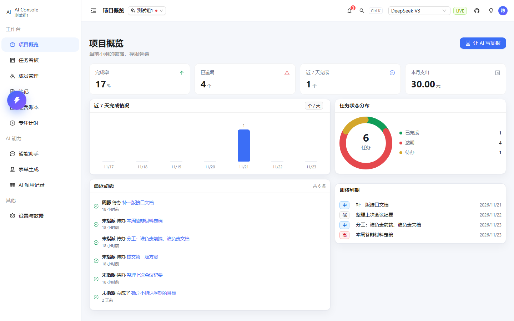

打开小组后的第一页，四张卡片 + 两张图 + 两块列表。

**四张指标卡**

| 指标 | 怎么算 |
|---|---|
| 完成率 | 已完成 ÷ 全部任务 |
| 已逾期 | 没完成、且截止时间已经过了的任务数 |
| 近 7 天完成 | 最近 7 天内完成的任务数 |
| 本月支出 | 这个月记的账目总和（按自然月） |

**两张图**

- **近 7 天完成情况**：每天完成几个任务，柱越高说明那天收得越多
- **任务状态分布**：已完成 / 逾期 / 待办 各占比，中间是任务总数

**两块列表**

- **最近动态**：谁完成了什么、谁在做什么，最近 6 条
- **即将到期**：按截止时间从近到远排的 4 条未完成任务

右上角「让 AI 写周报」会把当前任务数据整理成一段话发给助手，写出一份周报草稿，你可以在这个基础上改。

---

## 4. 任务看板

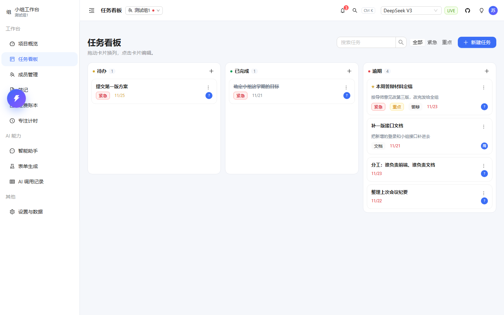

任务分成三列：

| 列 | 含义 |
|---|---|
| **待办** | 还没完成，且没到截止时间 |
| **已完成** | 已经做完的 |
| **逾期** | 还没完成，但截止时间已经过了 |

> 注意：「逾期」不是手动设置的状态，而是根据截止时间自动归到这一列的。所以把一个任务拖回「待办」时，它的截止时间会自动顺延到今天 18:00。

**新建任务**

右上角「新建任务」，或者在某一列标题右侧的 ➕ 直接在该列新建。

**编辑任务**

点任意一张卡片，右侧打开编辑面板：

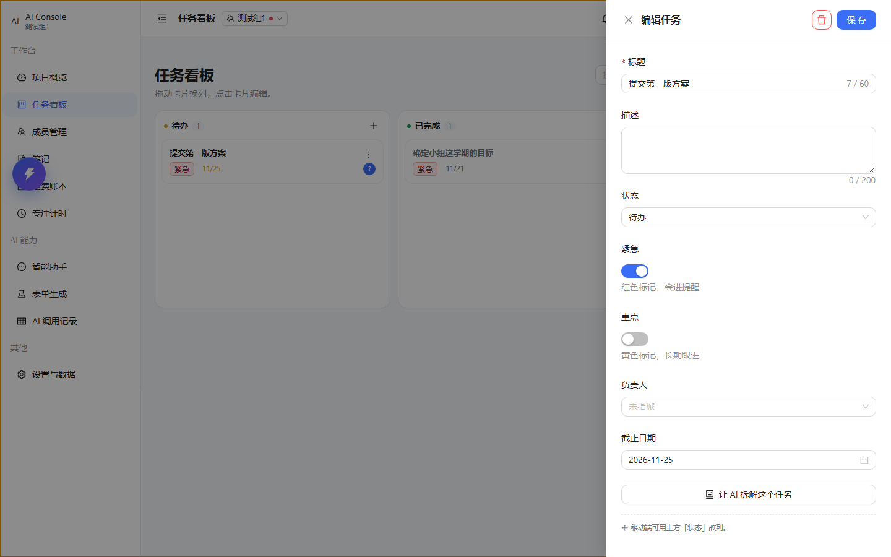

| 字段 | 说明 |
|---|---|
| 标题 | 必填，最多 60 字 |
| 描述 | 补充说明，最多 200 字 |
| 状态 | 待办 / 已完成 |
| 紧急 | 打开后卡片显示红色「紧急」，会进提醒 |
| 重点 | 打开后卡片显示黄色「重点」，标题前有 ★ |
| 负责人 | 从组员里选，只显示姓名 |
| 截止日期 | 选日期；过了这天还没完成就会进「逾期」列 |

面板底部还有「让 AI 拆解这个任务」，会带着标题跳到助手，让它拆成几个子任务。

**拖拽**

按住卡片拖到别的列即可。移动端不方便拖拽时，点开卡片改「状态」也一样。

**筛选**

右上角可以按「全部 / 紧急 / 重点」筛选，也可以直接搜任务标题。

**卡片右上角的 ⋮ 菜单**

- 标记重点 / 取消重点
- 让 AI 拆解
- 删除

---

## 5. 成员管理

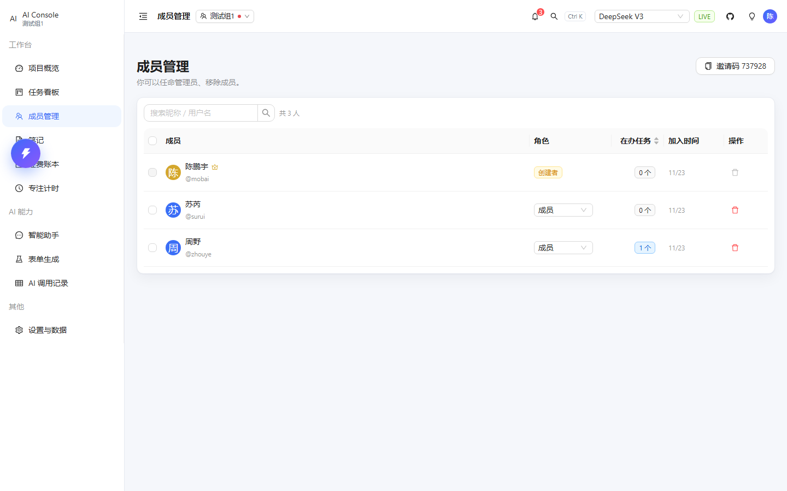

三种角色，权限不一样：

| 角色 | 能做什么 |
|---|---|
| **创建者** | 任命管理员、移除任何成员、管理一切 |
| **管理员** | 移除普通成员、管理任务和账目 |
| **成员** | 看数据、改任务、记自己的账，不能动成员 |

规则细节：

- 创建者不能被移除，也不能改自己的角色
- 只有创建者能任命管理员；管理员不能移除另一个管理员
- 移除某人后，他名下的任务会变成「未指派」

**拉人进来**：点右上角「邀请码 737928」，会复制到剪贴板，发给他，让他在「用邀请码加入」里输入。

普通成员看不到邀请码，需要向管理员要。

---

## 6. 笔记

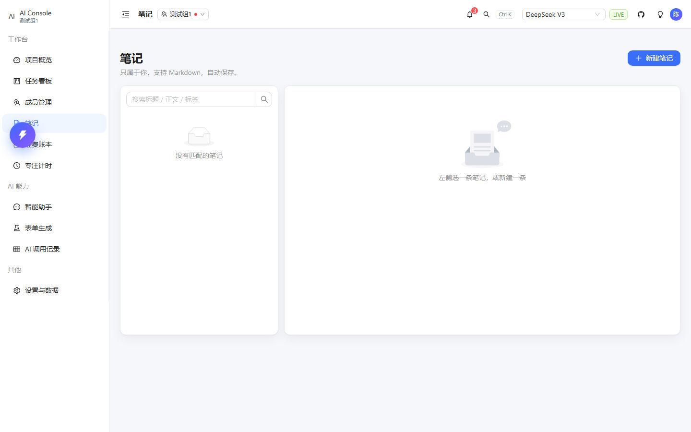

左边是列表，右边是编辑器。笔记只属于你自己，换小组也能看到。

**基本操作**

| 操作 | 怎么做 |
|---|---|
| 新建 | 右上角「新建笔记」 |
| 编辑 / 预览 | 右上角切换，预览会渲染 Markdown |
| 置顶 | 点图钉图标，置顶的排在最前面 |
| 搜索 | 顶部搜索框，可以搜标题、正文、标签 |
| 标签过滤 | 点标签（如 `#会议`）只看这一类 |
| 导出 | 下载成 `.md` 文件 |
| 删除 | 垃圾桶图标，删除后不可恢复 |

**自动保存**：停止输入约 0.6 秒就自动存，右上角会显示「已保存」。

**整理会议纪要**：工具栏的机器人图标会把这条笔记发给 AI，让它整理成「结论 / 待办 / 风险」的结构。

**分享给别人**

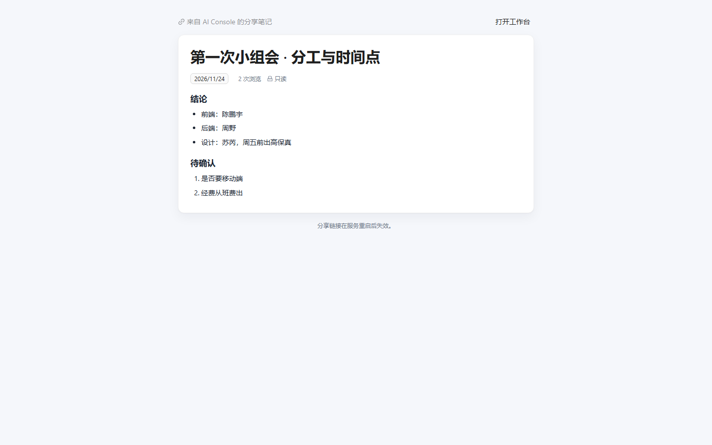

点分享图标 → 生成一个链接 → 复制发给别人。

- 对方打开看到的是**只读页面**，没有工作台导航，看不到你的任务和账本
- 你改了笔记，分享出去的**不会跟着变**（分享的是当时那一份）
- 点「撤销分享」，链接立即失效

---

## 7. 经费账本

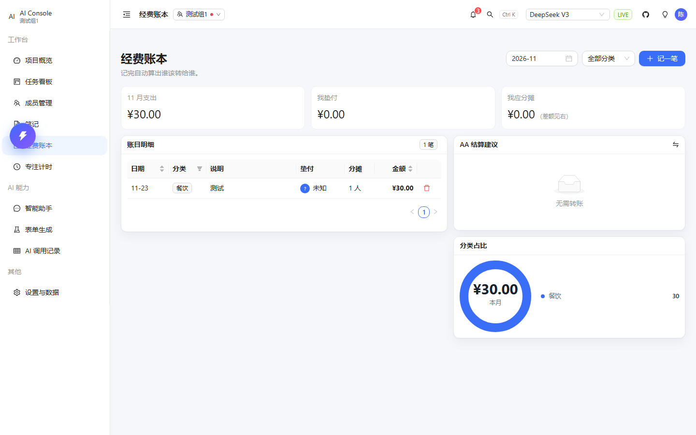

给班费、活动经费这类开销记账，重点是**自动算清谁该给谁转多少钱**。

**记一笔**

点右上角「记一笔」，填：金额、分类（餐饮/交通/采购/场地/其他）、说明、谁垫的钱、谁一起分摊、日期。

**AA 结算**

右侧「AA 结算建议」会直接告诉你谁转给谁多少钱，比如：

```
苏芮 → 陈鹏宇  ¥4.00
周野 → 陈鹏宇  ¥4.00
```

点「记一笔」的时候如果大家都分摊，系统按人头平均；也可以只选部分人分摊。

**其他**

- 顶部三张卡：本月支出、我垫付、我应分摊
- 「分类占比」环形图看钱花在哪一类
- 可以按月份、分类筛选；行尾垃圾桶可以删除账目（只能删自己记的，或者找管理员）

> 金额很大时会自动换成「万 / 亿」，比如 `¥111.11万`，不会把表格撑变形。

---

## 8. 专注计时

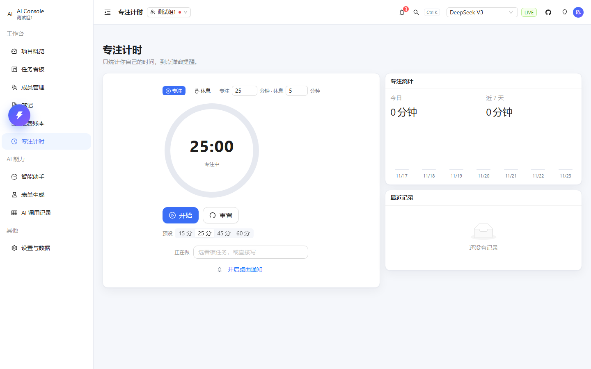

一个番茄钟，用来记录你真正在做事的时间。

**开始前**

- 选专注时长：预设 15 / 25 / 45 / 60 分钟，也能自己填（1–180）
- 选休息时长：默认 5 分钟
- 「正在做」可以**选一个看板任务**，也可以**直接打字写别的**

**计时中**

- 中间圆环会随剩余时间收缩
- 标签页标题会显示倒计时，切到别的页面也能瞄一眼
- 点「暂停」暂停，「重置」回到起点

**到点了会怎样**

1. 页面里弹一个提醒窗（不会自动跳页）
2. 响两声提示音
3. 如果允许了桌面通知，还会在系统层面弹一条——即使你在用别的软件也能看到

**统计**

右侧显示今日、近 7 天的专注分钟数，下面列出最近的记录。

> 专注记录只属于你个人，不随小组切换，换设备登录也能看到。

---

## 9. 智能助手

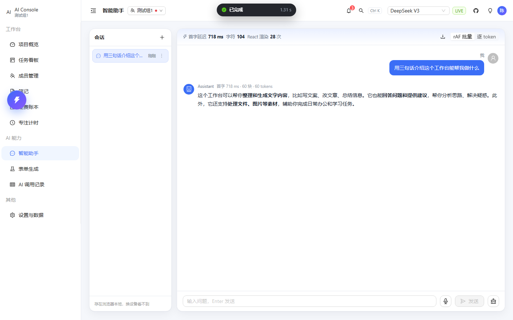

和 AI 对话，回答会一个字一个字显示出来。

**能做什么**

| 功能 | 说明 |
|---|---|
| 多会话 | 左侧是会话列表，可以新建、重命名、删除 |
| 重新生成 | 对回答不满意，点重新生成再试一次 |
| 停止生成 | 回答太长时点「停止」，已经出来的内容会保留 |
| 导出 | 把整段对话下载成 Markdown |
| 语音输入 | 点麦克风说话，识别结果会填进输入框 |
| 选模型 | 顶栏下拉可以切换不同模型 |

**顶部那条状态**

生成时顶部会显示一个小胶囊（等了多久、多少字），点开能看到这次回答的详细指标。

生成过程中还能切换「rAF 批量 / 逐 token」两种渲染方式，用来对比流畅度。

**从其他页面带问题过来**

- 概览页「让 AI 写周报」
- 看板卡片「让 AI 拆解」
- 笔记页「整理成会议纪要」

这些都会自动把内容带进对话，不用手动复制。

---

## 10. 表单生成

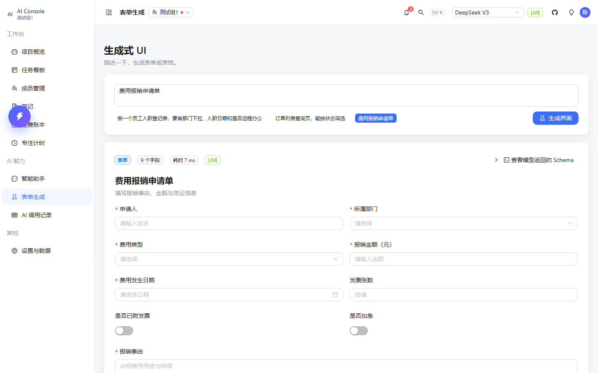

用一句话生成一个能填的表单。

**怎么用**

1. 在输入框里描述你要什么，比如「费用报销申请单」
2. 点「生成界面」
3. 下面直接出现可填写的表单，填完点提交

**内置三种常用单据**（生成结果固定，不会每次都不一样）：

| 单据 | 触发词 |
|---|---|
| 费用报销申请单 | 报销、费用、发票、差旅 |
| 请假申请单 | 请假、休假、调休 |
| 采购申请单 | 采购、申购、购买 |

其他描述（比如「员工入职登记表」「订单列表查询页」）会交给模型现场生成。

右侧「查看模型返回的 Schema」可以看到生成表单的结构，方便检查。

---

## 11. AI 调用记录

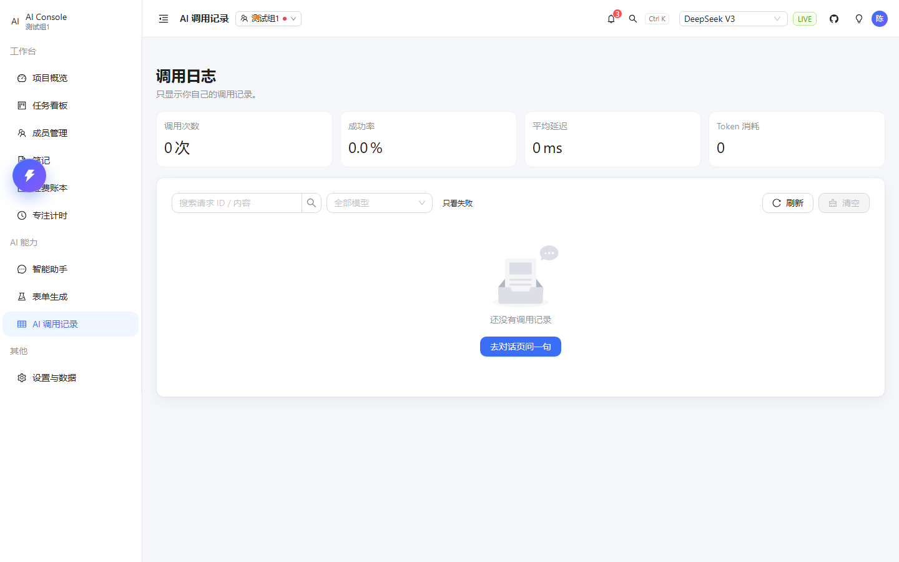

每次用 AI 都会记一条：用的哪个模型、成功还是失败、耗时多少、消耗多少 token、问了什么、答了什么。

- 只看得到**你自己的**记录
- 换设备登录后依然在
- 可以按模型筛选、只看失败的、搜索内容
- 「清空」只清你自己的

---

## 12. 小组切换与提醒

**切换小组**

点顶栏的小组名，中间弹出一层，像搜索框一样：

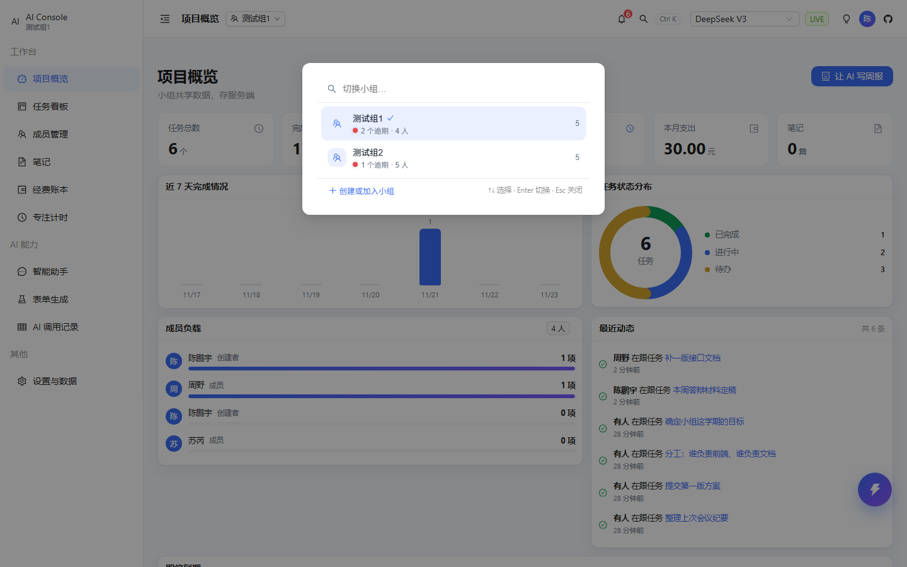

- 输入关键词过滤
- 上下键选择，回车切换，Esc 关闭
- 每行显示状态灯、人数、在办任务数
- 右上角的红点表示**其他小组有逾期任务**，不用点开也能看到

**任务提醒**

顶栏的铃铛是你欠处理的提醒，数字是**未读条数**。

只有两类任务会进提醒：
1. 今天到期或已逾期，并且标了「紧急」
2. 你标了「重点」的任务

点某一条会标成已读并跳到看板；底部有「全部标为已读」。

**进入小组时的提醒窗**

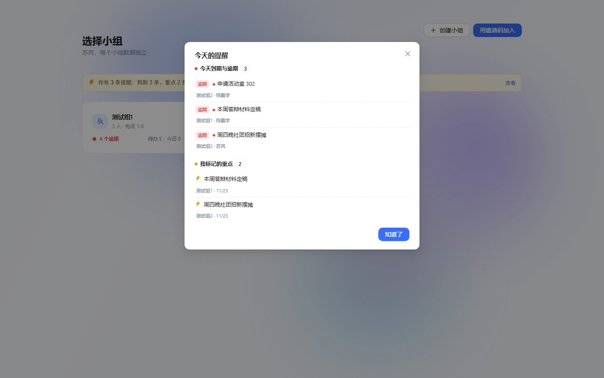

每天第一次进小组列表，如果存在上面两类任务，会自动弹一次，分「今天到期与逾期」「我标记的重点」两块，点任意一条直接跳到对应小组的看板。

关掉之后，页面顶部会留一条提示条，点「查看」可以再打开。

---

## 13. 设置与数据

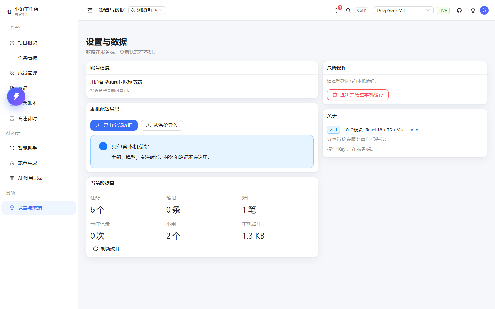

- **账号信息**：用户名、昵称
- **本机配置导出**：只导出主题、模型选择这类偏好，不含任务和笔记
- **当前数据量**：任务、笔记、账目、专注记录、小组的条数
- **退出并清空本机缓存**：清掉登录状态和本机偏好，服务端数据不受影响

---

## 14. 手机上使用

页面会自适应，手机上也能完整用：

<p>
  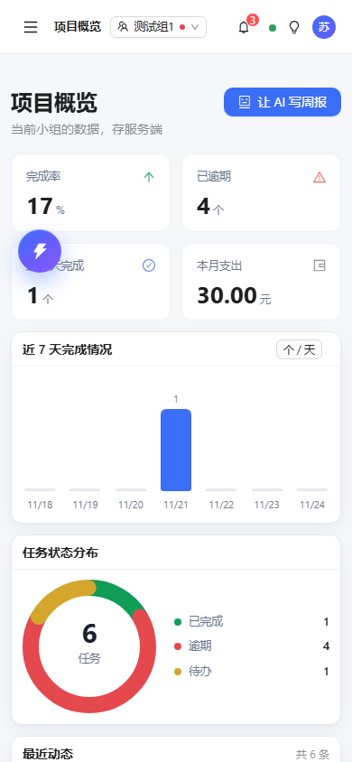
  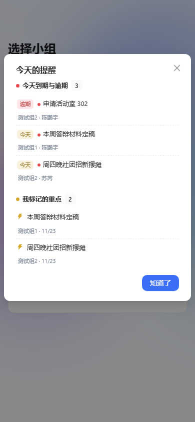
</p>

几点说明：

- 左上角 ☰ 打开导航
- 顶栏只保留常用入口，模型切换、主题、GitHub 收进了头像菜单
- 任务看板在手机上建议用「点开卡片改状态」代替拖拽
- 右下角悬浮球可以拖到任意位置，松手会吸附到最近的边缘

---

## 15. 数据说明

哪些数据跟着小组走，哪些只属于你：

| 范围 | 包括 |
|---|---|
| **小组级**（换小组就换一套，组员共享） | 项目概览、任务看板、成员、经费账本 |
| **个人级**（换小组不变，只有你自己看得到） | 专注计时、笔记、智能助手会话、调用记录 |

其他要知道的：

- 数据存在服务器上，换电脑登录同一个账号就能看到
- 密码在服务端加密保存，不会明文存储
- 分享出去的笔记是当时的**快照**，撤销后链接立即失效
- 会话记录和分享页存在服务内存里，服务重启后会失效

---

## 16. 常见问题

**忘记密码了怎么办？**
目前没有找回功能，需要找管理员（小组创建者）帮你重新建一个账号。

**邀请码在哪？**
成员管理页右上角，只有创建者和管理员能看到。复制后发给对方，让对方在「用邀请码加入」里输入。

**为什么别的组有任务，我看不到？**
数据按小组隔离。点顶栏小组名切换过去就能看到；如果别的小组有逾期，按钮上会有红点提示。

**为什么我标的「紧急」没进提醒？**
提醒只收「今天到期或已逾期」的紧急任务。截止日期在明天的不会提前提醒。

**任务跑到「逾期」列了，怎么弄回来？**
把它拖回「待办」，截止时间会自动顺延到今天 18:00；也可以点开卡片改截止日期。

**金额显示成「万」是什么意思？**
超过 1 万自动换算，`¥111.11万` 就是 111 万 1100 元。点开账目明细能看到原始金额。

**AI 回答到一半停了？**
点「停止」会保留已生成的部分；重新生成会重新回答。如果提示调用太频繁，等一分钟再试。

**手机上拖不动卡片？**
手机浏览器对拖拽支持有限，点开卡片改「状态」效果一样。

---

## 17. 配置自己的 Key（让 AI 真正可用）

**这个项目不附带任何 API Key。** 两种情况下能做的事不一样：

| 情况 | 会发生什么 |
|---|---|
| **没有 Key** | 模型下拉只有「内置模拟」。对话能发、表单能生成、界面全都能点，但回复是预设内容；熟悉功能和演示给别人看够用。 |
| **有 Key** | 下拉里出现真实模型（DeepSeek、百炼、硅基流动、智谱、火山）。对话、写周报、拆解任务、会议纪要、表单生成都走真实模型。 |

### 怎么填（以 DeepSeek 为例）

1. **创建 Key**：登录 platform.deepseek.com，进「API Keys」点创建，复制 `sk-` 开头那串。只显示一次，先存好。
2. **找到 .env**：项目根目录下；只有 `.env.example` 的话，复制一份改名成 `.env`。
3. **填进去**：记事本打开，在 `DEEPSEEK_API_KEY=` 后面直接粘贴，不加引号、不留空格。
4. **重启服务**：关掉服务窗口，重新双击 `start.bat` 或 `npm run dev`。不重启不生效。
5. **选模型**：刷新页面，右上角下拉从「内置模拟」变成真实模型，选中即可。

```
DEEPSEEK_API_KEY=sk-你的真实Key
DEEPSEEK_BASE_URL=https://api.deepseek.com/v1
```

### 几点说明

- **只填一个就够**：填哪个供应商的 Key，下拉里就出现哪家的模型。
- **Key 不会跟着项目走**：`.env` 在 `.gitignore` 里，传到 GitHub 不会带上；别人要用得填自己的。
- **想省钱**：硅基流动和智谱有免费模型，字段名在 `.env.example` 里都列好了。
- **对外开放前**：加 `ALLOW_REGISTER=0` 再重启，避免别人注册后消耗你的额度。

> **一句话**：只想看看或演示，不用配 Key；想真正用起来，填一个就够了。
